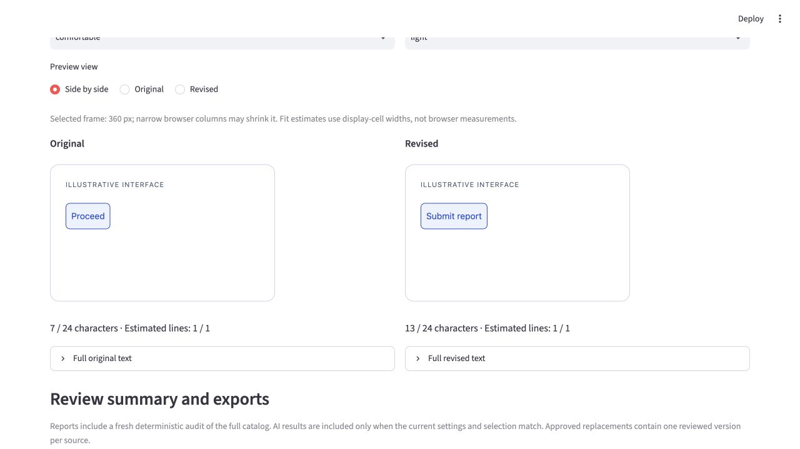
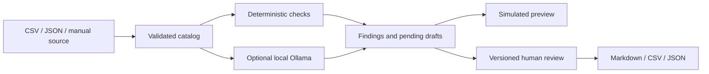

# Microcopy Lab: a local UX writing review workflow

Microcopy Lab turns a file of interface strings into a traceable editorial review: import text with its context, run explainable rules, optionally request local AI suggestions, compare wording in a simulated component, make a human decision, and export the result. Version 1.0 is a local prototype for UX writers, technical writers, content designers and product designers.

The demonstration uses fictional FleetOps maintenance software. It contains no customer data, production requirements or measured product usability results.

## The problem and intended outcome

Short interface text can conceal an important action. “Proceed” might move to another screen, submit a report, or confirm a destructive operation. A grammar correction cannot determine which behavior is true. The review therefore needs component type, user context, verified product behavior, terminology, length limits and technical placeholders alongside the words.

The outcome is an inspectable recommendation with source evidence and an explicit human decision. The app does not modify the product or publish copy.

## A concrete editorial example

The fictional source button says **Proceed**. Its supplied requirement says that **Submit report sends the current draft report for supervisor review**. The deterministic rule flags a generic button label. A human-authored candidate, **Submit report**, names the action and fits the 24-character limit. A final live local-model smoke run independently proposed **Submit Report** as a pending candidate; that model output is kept distinct from the human-authored example.

In the component preview, the reviewer can compare the two labels, read exact character counts and inspect the full wording. Approval requires a separate behavior-confirmation action. Editing approved text creates a new pending version, so an earlier decision cannot silently approve different wording. An error such as **Error 42**, with no verified cause or recovery description, instead produces clarification questions in the live test and no revision.



## Architecture and engineering choices



Streamlit handles forms, tables, previews and downloads. The Python engine owns validation, terminology, placeholders, analysis, review state and export generation. Keeping the engine independent makes it callable in tests and an offline demonstration script, and permits a future interface without rewriting those rules.

Pydantic records preserve source identifiers and extra metadata. Deterministic findings have reproducible rule IDs and evidence. The app stores original content, initial AI candidates, human-edited drafts and accepted replacement mappings separately. Reports identify the style guide, application version and model where applicable.

AI runs through a narrow adapter with numeric-loopback endpoints, installed local-weight metadata checks, structured output, time/record/byte limits, no redirects/proxies/tools, and no automatic model downloads. Candidate checks require exact supplied behavior evidence and conservative vocabulary, terminology, numeric, negation, fit and token checks. These can reject useful paraphrases and cannot establish factual meaning; human confirmation remains necessary.

Fixed preview templates escape source/generated content into text nodes. They show approximate interface context while explicitly distinguishing code-point length from visual fit estimates. An inert button can illustrate wording without pretending to be a working product action.

CSV exports neutralize spreadsheet formula prefixes. JSON preserves exact text and metadata. Markdown escapes imported HTML and image/link syntax. Export generation remains in memory, and file downloads require an explicit control.

## Development and evaluation

The work followed six bounded milestones: validated input foundation; reproducible rules; optional local inference; visual previews; editorial review/export; and release QA/documentation. Each stage added executable evidence before expanding the workflow.

Guided user testing exposed two preview problems: repeated fixture loading reset the selected string, and live Python module reloads made retained Pydantic/enum instances incompatible despite valid data. The fixes preserved selection and revalidated retained records through JSON at reload boundaries. Regression tests now exercise those failures.

Release review also found that manual entry had no existing-source editor, despite the acceptance requirement. The final editor preserves IDs/extensions, validates edits atomically, keeps files on disk unchanged and makes prior affected approvals stale until explicit rebase/review. A positional UI test broke when the editor added a button; selecting controls by label fixed the brittle test without weakening its assertions.

The repository includes a human-authored 40-string sample with expected deterministic findings, a smaller nine-case guided catalog, deliberate invalid inputs, five paired preview examples and a scripted offline editorial session. scripts/run_demo.py produces all four decision states and one approved replacement without contacting a model or external service. Test and live-run results, timing and coverage limits are recorded in release_validation.md and acceptance_matrix.md.

No editorial acceptance rate, real-user task improvement, automated WCAG compliance or broad model-accuracy claim was measured. Tests establish the exercised functional boundaries; they do not substitute for product-owner verification or usability research.

## Demonstrating the work

Run the local app and follow portfolio_demo.md for a concise browser walkthrough. For reproducible export artifacts, run:

```sh
.venv/bin/python scripts/run_demo.py --output work/demo-output
```

This creates a separate fictional project: nine source strings, seven deterministic findings, four scripted drafts (one in each review state), and one approved replacement. It cannot access or change the browser's current session.

## Remaining boundaries

The app is session-based, with no database, durable project reopen workflow, accounts, production integrations, automatic source rewrite, publication or cloud inference. Reports must be downloaded before ending a session. Preview estimates do not certify production layout, device behavior or accessibility. Local operation depends on trusting the computer and the configured Ollama daemon. Cross-platform and assistive-technology validation remain future work.
